<a href="https://lexfive.com">
  <picture>
    <source media="(prefers-color-scheme: dark)" srcset="assets/banner-dark.svg">
    <source media="(prefers-color-scheme: light)" srcset="assets/banner-light.svg">
    
  </picture>
</a>

  
  
  

> **Agora:** Samantha Robotics — a câmera no braço robótico aprendendo a acompanhar objetos. · [mais em lexfive.com/#agora](https://lexfive.com/#agora)

Construo sistemas modulares, infraestrutura confiável e ferramentas que resolvem problemas reais — do servidor ao pixel.

- Opero a **Lexfive Stack**, focada em produtos digitais e infraestrutura.
- Desenvolvo o ecossistema modular **Samantha** (Nomad, Pocket, Nixy, Khaiju e Zentrix) — ela também é a mascote do meu site.
- Integro agentes e automações com **MCP**, **RAG** e fluxos no **n8n**.
- Administro um **homelab** com Docker, Ubuntu Server e Pterodactyl, em rede sob CGNAT com MikroTik e Tailscale.

## Apps

| | App | O que faz |
|---|---|---|
| 🟢 | **[Vanta](https://apps.lexfive.com/vanta/)** | Workspace desktop para o WhatsApp Web, feito para equipes: várias contas, PIN, respostas prontas. |
| 🟣 | **[SkärmCast](https://apps.lexfive.com/skarmcast/)** | Compartilhe a tela com áudio para várias pessoas pela internet, em salas fixas. |
| 🔵 | **[Kaption Cleaner](https://apps.lexfive.com/kaption-cleaner/)** · [código](https://github.com/Lexfive/Kaption-Cleaner) | Diagnóstico e remoção segura do Kaption.ai no Google Chrome. |

Todos para Windows, gratuitos, em <a href="https://apps.lexfive.com">apps.lexfive.com</a>.

## Stack

  
  &nbsp;
  
  &nbsp;
  

e também n8n, MikroTik RouterOS, Tailscale, Tauri e Rust.

## Atividade

<picture>
  <source media="(prefers-color-scheme: dark)" srcset="assets/stats-dark.svg">
  <source media="(prefers-color-scheme: light)" srcset="assets/stats-light.svg">
  
</picture>

<picture>
  <source media="(prefers-color-scheme: dark)" srcset="https://raw.githubusercontent.com/Lexfive/Lexfive/output/github-snake-dark.svg">
  <source media="(prefers-color-scheme: light)" srcset="https://raw.githubusercontent.com/Lexfive/Lexfive/output/github-snake.svg">
  
</picture>

<picture>
  <source media="(prefers-color-scheme: dark)" srcset="assets/ai-dark.svg">
  <source media="(prefers-color-scheme: light)" srcset="assets/ai-light.svg">
  
</picture>

Muito do meu trabalho é local e em repositórios privados: o cartão acima conta minhas sessões de desenvolvimento com Claude Code, Codex e Gemini (só a contagem por dia). Cartões gerados por GitHub Actions neste repositório (<code>scripts/</code>), sem serviços de terceiros.
